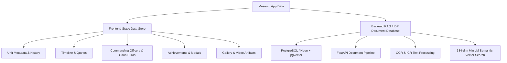

# 🏛️ Assam Regiment Digital Museum — Complete Data Reference & Frontend Schema

This document provides a comprehensive, structured reference for all datasets, schema definitions, TypeScript interfaces, database models, and JSON structures used in the **Assam Regiment Digital Museum & RAG Application**. Frontend developers can use this guide to quickly build, render, and wire up application views.

---

## 📐 Table of Contents
1. [Architecture Overview](#1-architecture-overview)
2. [Backend RAG & Document Database Schema](#2-backend-rag--document-database-schema)
3. [Frontend Museum Data Models (TypeScript Interfaces)](#3-frontend-museum-data-models-typescript-interfaces)
4. [Detailed Entity Schemas & JSON Templates](#4-detailed-entity-schemas--json-templates)
   - [Metadata & Unit Bio](#meta--unit-biography)
   - [Historical Narrative & Overview](#historical-narrative--overview)
   - [Timeline Entries](#timeline-entries)
   - [Inspirational Quotes](#inspirational-quotes)
   - [Highlights & Quick Stats](#highlights--quick-stats)
   - [Commanding Officers Directory](#commanding-officers-directory)
   - [Gaon Buras / Tribal Elders](#gaon-buras--tribal-elders)
   - [Honors & Achievements](#honors--achievements)
   - [Museum Gallery Artifacts](#museum-gallery-artifacts)
   - [Archival Video Library](#archival-video-library)
5. [Regimental Units Catalog](#5-regimental-units-catalog)
6. [Frontend View Component Mapping](#6-frontend-view-component-mapping)
7. [Complete Ready-to-Use Sample JSON Data](#7-complete-ready-to-use-sample-json-data)

---

## 1. Architecture Overview

The Digital Museum platform operates on two primary data streams:



---

## 2. Backend RAG & Document Database Schema

The backend uses a PostgreSQL/Neon database (`documents` table) with the `pgvector` extension for storing scanned archives, war diaries, historical photographs, and intelligent document processing (IDP) metadata.

### 🗄️ Database DDL (PostgreSQL)

```sql
-- Enums
CREATE TYPE processingstatus AS ENUM (
    'pending',
    'in_progress',
    'done',
    'failed',
    'skipped',
    'not_applicable'
);

-- Documents Table
CREATE TABLE documents (
    id UUID PRIMARY KEY DEFAULT gen_random_uuid(),
    title VARCHAR NOT NULL,
    category VARCHAR,           -- e.g. "War Diary", "Photograph", "Gallantry Citation"
    collection VARCHAR,         -- e.g. "Gallantry Awards", "Burma Campaign"
    file_path VARCHAR NOT NULL,  -- Local relative path or cloud storage URL
    file_type VARCHAR NOT NULL,  -- e.g. "pdf", "png", "jpg", "mp4", "mp3", "wav"
    ocr_status processingstatus NOT NULL DEFAULT 'pending',
    icr_status processingstatus NOT NULL DEFAULT 'pending',
    ocr_text TEXT,               -- Extracted text from machine-printed document
    icr_text TEXT,               -- Extracted text from handwritten document/note
    tags VARCHAR,                -- Comma-separated tags (e.g. "Kohima, 1944, Award")
    description TEXT,            -- Human summary or editorial overview
    embedding vector(384),       -- 384-dimensional dense vector (all-MiniLM-L6-v2)
    metadata_json JSONB,         -- Structured extracted entity metadata
    created_at TIMESTAMP DEFAULT (now() at time zone 'utc'),
    updated_at TIMESTAMP DEFAULT (now() at time zone 'utc')
);
```

### 📦 Document `metadata_json` Schema
```json
{
  "year": "1944",
  "regiment": "1st Battalion, Assam Regiment",
  "operation": "Battle of Kohima",
  "officer": "Lt. Col. Brown",
  "place": "Kohima, Nagaland",
  "battle": "Burma Campaign",
  "keywords": ["WWII", "Defense", "Jungle Warfare"]
}
```

---

## 3. Frontend Museum Data Models (TypeScript Interfaces)

Source File: [`frontend/src/types/index.ts`](file:///c:/Users/hanuk/museum-rag/frontend/src/types/index.ts)

```typescript
// Timeline Event Entry
export interface TimelineEntry {
  year: string;
  title: string;
  description: string;
  significance?: string;
}

// Historical or Leadership Quote
export interface Quote {
  text: string;
  author: string;
  designation: string;
}

// Quick Statistics / Highlights
export interface Highlight {
  label: string;
  value: string;
}

// Commanding Officers & Leaders
export interface CommandingOfficer {
  name: string;
  rank: string;
  tenure: string;
  bio: string;
  contribution: string;
  image: string;
}

// Gaon Buras (Tribal Chiefs / Elders connected to regiment)
export interface GaonBura {
  name: string;
  tribe: string;
  era: string;
  role: string;
  contribution: string;
}

// Honors & Achievements
export interface Achievement {
  category: string;
  title: string;
  description: string;
  year: string;
  icon: string;
}

// Museum Artifact & Photo Gallery
export interface GalleryItem {
  id: number;
  src: string;
  caption: string;
  category: string;
  year: string;
  history?: string;
}

// Archival & Educational Video
export interface VideoItem {
  title: string;
  description: string;
  youtubeId: string;
  thumbnail: string;
  duration: string;
  year: string;
  featured: boolean;
  videoUrl?: string;
}

// Master Unit Data Structure
export interface UnitData {
  meta: Record<string, string | string[]>;
  history: {
    overview: string;
    paragraphs: string[];
    timeline: TimelineEntry[];
    quotes: Quote[];
    highlights: Highlight[];
  };
  commandingOfficers: CommandingOfficer[];
  gaonBuras?: GaonBura[];
  achievements: Achievement[];
  gallery: GalleryItem[];
  videos: VideoItem[];
}
```

---

## 4. Detailed Entity Schemas & JSON Templates

### Meta & Unit Biography
```json
{
  "name": "Assam Regimental Centre",
  "shortName": "ARC",
  "motto": "Asam Vikram",
  "mottoMeaning": "Unique Valour",
  "warCry": "Rhino Charge!",
  "salutation": "Tagra Raho",
  "established": "15 June 1941",
  "location": "Happy Valley, Shillong, Meghalaya",
  "symbol": "One-Horned Rhinoceros",
  "nickname": "The Rhinos",
  "colors": "Scarlet Red, Olive Green & Black",
  "affiliation": "Indian Army — Eastern Command"
}
```

### Historical Narrative & Overview
```json
{
  "overview": "The Assam Regimental Centre (ARC), nestled in Happy Valley, Shillong, serves as the administrative and training heartbeat of the Assam Regiment.",
  "paragraphs": [
    "On 15 June 1941, Lt. Col. Ross Howman raised the 1st Battalion near Elephant Falls in Shillong.",
    "The regiment distinguished itself in the Burma Campaign (1942–1945), earning hard-won battle honours at Kohima and Jessami."
  ]
}
```

### Timeline Entries
```json
[
  {
    "year": "1941",
    "title": "Founding of the Assam Regiment",
    "description": "Lt. Col. Ross Howman raises the 1st Battalion near Elephant Falls, Shillong on 15 June.",
    "significance": "Birth of the Regiment"
  },
  {
    "year": "1944",
    "title": "Battle of Kohima",
    "description": "Assam Regiment soldiers hold back imperial forces in vital high-altitude defensive operations.",
    "significance": "Turning Point of WWII"
  }
]
```

### Inspirational Quotes
```json
[
  {
    "text": "The men of Assam Regiment fight with a ferocity and skill that is unmatched in jungle warfare.",
    "author": "Field Marshal William Slim",
    "designation": "Commander, 14th Army"
  }
]
```

### Highlights & Quick Stats
```json
[
  { "label": "Battle Honours", "value": "7 Pre-Independence & 6 Post-Independence" },
  { "label": "Maha Vir Chakras", "value": "5" },
  { "label": "Vir Chakras", "value": "43" },
  { "label": "Ashoka Chakras", "value": "2" }
]
```

### Commanding Officers Directory
```json
[
  {
    "name": "Lt. Col. Ross Howman",
    "rank": "Lieutenant Colonel",
    "tenure": "1941 – 1943",
    "bio": "First Commandant and founder of the Assam Regiment at Shillong.",
    "contribution": "Raised the 1st Battalion and built initial regimental infrastructure.",
    "image": "/assami/officers/howman.jpg"
  }
]
```

### Gaon Buras / Tribal Elders
```json
[
  {
    "name": "Gaon Bura Thangi Kuki",
    "tribe": "Kuki",
    "era": "World War II (1944)",
    "role": "Village Chief & Scout Guide",
    "contribution": "Provided critical terrain intelligence during the Burma Campaign."
  }
]
```

### Honors & Achievements
```json
[
  {
    "category": "Gallantry Award",
    "title": "Ashoka Chakra",
    "description": "Awarded for exceptional bravery during counter-insurgency operations.",
    "year": "1995",
    "icon": "medal"
  }
]
```

### Museum Gallery Artifacts
```json
[
  {
    "id": 101,
    "src": "/assami/gallery/kohima_flag.jpg",
    "caption": "Captured Battle Standard from Kohima",
    "category": "War Trophies",
    "year": "1944",
    "history": "Preserved standard recovered during operations in Burma."
  }
]
```

### Archival Video Library
```json
[
  {
    "title": "Rhino Charge: History of Assam Regiment",
    "description": "Documentary covering the 80-year legacy of the regiment.",
    "youtubeId": "dQw4w9WgXcQ",
    "thumbnail": "/assami/videos/thumb_doc.jpg",
    "duration": "14:25",
    "year": "2021",
    "featured": true,
    "videoUrl": "/uploads/15f6156e-5970-484c-8b07-9880eccce863.mp4"
  }
]
```

---

## 5. Regimental Units Catalog

The repository includes data files for the primary regimental divisions:

| Unit / Division | Data File Path | Description |
| :--- | :--- | :--- |
| **Assam Regimental Centre (ARC)** | [`frontend/src/data/arc.ts`](file:///c:/Users/hanuk/museum-rag/frontend/src/data/arc.ts) | Regimental Headquarters & Training Establishment (Shillong) |
| **Assam Rifles** | [`frontend/src/data/assam-rifles.ts`](file:///c:/Users/hanuk/museum-rag/frontend/src/data/assam-rifles.ts) | Sentinels of the North East & Frontier Units |
| **Rashtriya Rifles** | [`frontend/src/data/rashtriya-rifles.ts`](file:///c:/Users/hanuk/museum-rag/frontend/src/data/rashtriya-rifles.ts) | Counter-insurgency Force (Affiliated Battalions) |
| **Territorial Army** | [`frontend/src/data/territorial-army.ts`](file:///c:/Users/hanuk/museum-rag/frontend/src/data/territorial-army.ts) | Infantry Battalions & Ecological Units |
| **Arunachal Scouts** | [`frontend/src/data/arunachal-scouts.ts`](file:///c:/Users/hanuk/museum-rag/frontend/src/data/arunachal-scouts.ts) | High-altitude mountain border defenders |

---

## 6. Frontend View Component Mapping

| Frontend View / Component | Relevant Data Fields | UI Rendering Pattern |
| :--- | :--- | :--- |
| **Hero Section** | `meta.name`, `meta.motto`, `meta.salutation`, `meta.location` | Large hero banner with badge logo, motto overlay, and call-to-action buttons. |
| **Quick Stats Bar** | `history.highlights` (`label`, `value`) | Grid cards showing count of Medals, Battle Honours, and Raising Year. |
| **History & Interactive Timeline** | `history.overview`, `history.timeline` (`year`, `title`, `description`, `significance`) | Horizontal or vertical stepper component with year filtering. |
| **Commanders & Leaders Carousel** | `commandingOfficers` (`name`, `rank`, `tenure`, `bio`, `image`) | Avatar cards with modal popup for detailed military biography. |
| **Tribal Connection & Elders** | `gaonBuras` (`name`, `tribe`, `role`, `contribution`) | Tribal heritage section highlighting community participation. |
| **Gallantry & Honours Board** | `achievements` (`title`, `category`, `year`, `description`) | Filterable grid by award type (Ashoka Chakra, MVC, Vir Chakra). |
| **Museum Artifacts Gallery** | `gallery` (`src`, `caption`, `category`, `year`, `history`) | Masonry gallery with lightbox preview and category pills. |
| **Archival Video Cinema** | `videos` (`title`, `videoUrl`, `youtubeId`, `thumbnail`, `duration`) | Video player modal / HTML5 embed container. |
| **RAG Document Search Engine** | Database `documents` (`title`, `category`, `ocr_text`, `icr_text`, `tags`) | AI search bar powered by `/api/v1/search` endpoint. |

---

## 7. Complete Ready-to-Use Sample JSON Data

Save this as `museum_data_sample.json` or paste it into your API mock server:

```json
{
  "meta": {
    "name": "Assam Regimental Centre",
    "shortName": "ARC",
    "motto": "Asam Vikram",
    "mottoMeaning": "Unique Valour",
    "warCry": "Rhino Charge!",
    "salutation": "Tagra Raho",
    "established": "15 June 1941",
    "location": "Happy Valley, Shillong, Meghalaya",
    "symbol": "One-Horned Rhinoceros",
    "nickname": "The Rhinos",
    "colors": "Scarlet Red, Olive Green & Black",
    "affiliation": "Indian Army — Eastern Command"
  },
  "history": {
    "overview": "The Assam Regimental Centre (ARC), located in Happy Valley, Shillong, stands as the administrative and training heartbeat of the Assam Regiment.",
    "paragraphs": [
      "On 15 June 1941, Lt. Col. Ross Howman raised the 1st Battalion near Elephant Falls in Shillong.",
      "The regiment distinguished itself in the Burma Campaign (1942–1945), earning battle honours at Kohima and Jessami."
    ],
    "timeline": [
      {
        "year": "1941",
        "title": "Founding of the Assam Regiment",
        "description": "Lt. Col. Ross Howman raises the 1st Battalion on 15 June in Shillong.",
        "significance": "Birth of the Regiment"
      },
      {
        "year": "1944",
        "title": "Battle of Kohima",
        "description": "Crucial defense of Kohima ridge against imperial forces.",
        "significance": "World War II Victory"
      },
      {
        "year": "1971",
        "title": "Liberation War",
        "description": "Assam Regiment battalions participate in Bangladesh liberation.",
        "significance": "National Honor"
      }
    ],
    "quotes": [
      {
        "text": "Tagra Raho — Stay strong, stay fit, stay vigilant.",
        "author": "Commandant, ARC",
        "designation": "Assam Regimental Centre"
      }
    ],
    "highlights": [
      { "label": "Established", "value": "1941" },
      { "label": "Battle Honours", "value": "13" },
      { "label": "Maha Vir Chakras", "value": "5" },
      { "label": "Ashoka Chakras", "value": "2" }
    ]
  },
  "commandingOfficers": [
    {
      "name": "Lt. Col. Ross Howman",
      "rank": "Lieutenant Colonel",
      "tenure": "1941 – 1943",
      "bio": "First Commandant and founder of the Assam Regiment.",
      "contribution": "Established training procedures and regimental traditions.",
      "image": "/assami/officers/howman.jpg"
    }
  ],
  "gaonBuras": [
    {
      "name": "Gaon Bura Thangi Kuki",
      "tribe": "Kuki",
      "era": "WWII",
      "role": "Scout Leader",
      "contribution": "Guided Allied forces through steep hill terrain."
    }
  ],
  "achievements": [
    {
      "category": "Gallantry Award",
      "title": "Ashoka Chakra",
      "description": "Conferred for supreme bravery in operational duty.",
      "year": "1995",
      "icon": "medal"
    }
  ],
  "gallery": [
    {
      "id": 1,
      "src": "/assami/gallery/rhino_statue.jpg",
      "caption": "The Iconic Rhino Statue at ARC Shillong",
      "category": "Monuments",
      "year": "1950",
      "history": "Erected at the main parade ground of Happy Valley."
    }
  ],
  "videos": [
    {
      "title": "History of Assam Regiment",
      "description": "Archival documentary detailing regimental history.",
      "youtubeId": "dQw4w9WgXcQ",
      "thumbnail": "/assami/videos/thumb.jpg",
      "duration": "10:30",
      "year": "2021",
      "featured": true,
      "videoUrl": "/uploads/15f6156e-5970-484c-8b07-9880eccce863.mp4"
    }
  ]
}
```
